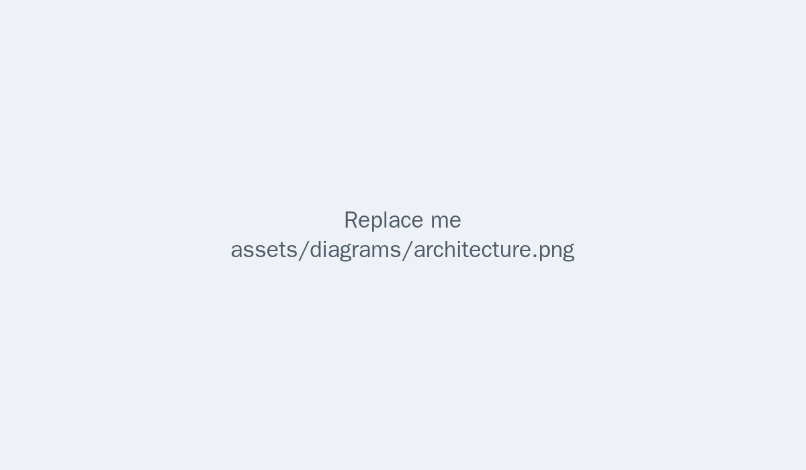
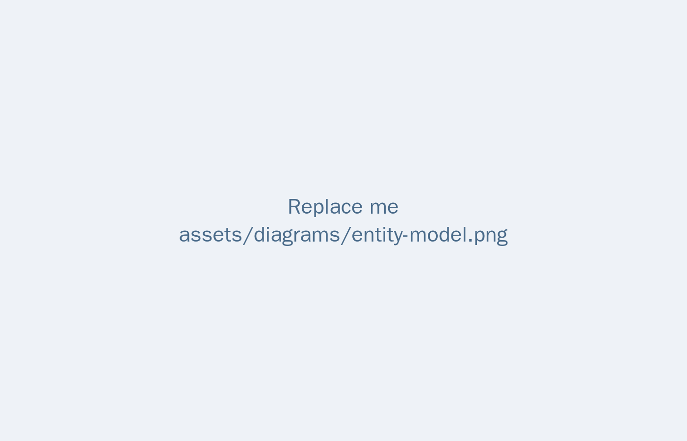

# {{CHAPTER_TITLES.2}} {#sec-design}

## Introduction {.unnumbered}

This chapter presents the design of {{PROJECT_NAME_DISPLAY}}: the system
architecture, the domain model, the API design, the UI/UX considerations, the
technology choices, and the AI integration design.

<!-- TODO: Re-write for your project. -->

## System Architecture

{{PROJECT_DESCRIPTION}} The architecture follows a modular design where each
business capability is an independent <app/> named module.

{#fig-architecture fig-pos="H" width=85%}

<!-- TODO: Replace the diagram with your architecture diagram and describe:
the components, how they communicate (REST/messaging), the data flows, and the
deployment model ({{DEPLOYMENT_METHOD}}). -->

## Domain Modeling

The core domain entities are modeled with {{VALIDATION_LIBRARY}} (e.g., Pydantic
or dataclasses), ensuring structured validation and one source of truth across
the API and the workers. The central entity of the domain is the
\acrs{PROJECT_ENTITY}, modeled as follows:

<!-- TODO: Replace this code block with your core domain model:
```python
class AtomicTask(BaseModel):
    id: str
    title: str
    description: str
    ...  # replace with your own fields
```
-->

```python
class AtomicTask(BaseModel):
    id: str
    title: str
    description: str
```

{#fig-entity-model width=85%}

<!-- TODO: Describe how the domain model maps to your data storage
(database / Redis / document store). -->

## API Design

The platform exposes a RESTful API (\acr{HTTP}) grouped by module. The main
endpoints are summarized below.

| {{MODULE}} | {{METHOD}} | {{PATH}}                      | {{DESCRIPTION}} |
| ---------- | ---------- | ---------------------------- | --------------- |
| Module 1   | GET        | `/api/v1/module1`            | ...             |
| Module 1   | POST       | `/api/v1/module1`            | ...             |
| Module 1   | GET        | `/api/v1/module1/<id>`       | ...             |
| Module 2   | POST       | `/api/v1/module2`            | ...             |
| Module 2   | GET        | `/api/v1/module2/<id>`       | ...             |
| ...        | ...        | ...                          | ...             |

: Main API endpoints {#tbl-api-endpoints tbl-colwidths="[14,11,41,34]"}

<!-- TODO: Replace the paths with your real endpoints.
Tips for long paths: split them with a forced line break inside the cell:
`/api/v1/.../` `\newline`{=latex} `segment`
and check that method cells (GET/POST/PUT/DELETE) fit their column. -->

## UI / UX Considerations

The platform's primary interface is its API, and the user experience is shaped
through response design rather than screens. The main decisions were:

<!-- TODO: Describe your UI/UX decisions (e.g., response design, dashboards,
human-in-the-loop approvals, status transparency). -->

- **Decision 1** — one line.
- **Decision 2** — one line.
- **Decision 3** — one line.

## Technology Choices

### Web framework

<!-- TODO: describe the chosen web framework and why. -->

### Data and messaging

<!-- TODO: describe the database, cache, and message broker choices. -->

### Validation and serialization

<!-- TODO: describe the schema/validation library (e.g., Pydantic) and why. -->

### Messaging and background work

<!-- TODO: describe async task handling and queue technology. -->

### Testing

<!-- TODO: describe the test framework and coverage strategy. -->

### Deployment

<!-- TODO: describe containerization and deployment ({{DEPLOYMENT_METHOD}}). -->

## AI Integration Design

<!-- TODO: Replace this section with the AI integration choices for your
project. The original report used the following structure. -->

### The unified client

<!-- TODO: describe the single access point to LLM providers (e.g., a proxy)
and the provider list. -->

### Taming unstructured output

<!-- TODO: describe how unstructured LLM output is validated (schemas, retries,
confidence scores). -->

### Provider mapping and fallback

| {{CAPABILITY}} | {{MODEL_ALIAS}}      | {{PROVIDER}} / {{MODEL}}    | {{USE_CASE}} |
| -------------- | -------------------- | --------------------------- | ------------ |
| `capability_1` | `model-1`            | Provider `model-name`       | ...          |
| `capability_2` | `model-2`            | Provider `model-name`       | ...          |

: Capability-to-model mapping {#tbl-capability-model tbl-colwidths="[25,20,33,22]"}

<!-- TODO: Fill with your real capability → model → provider mapping.
Long token tip: `capability_` `\newline`{=latex} `suffix` for overflowing cells. -->

### Hybrid pipeline design

<!-- TODO: describe a hybrid pipeline if your project mixes deterministic
processing with generative steps. -->

## Conclusion {.unnumbered}

This chapter presented the design of {{PROJECT_NAME_DISPLAY}}. The next chapter
describes its implementation.

<!-- TODO: Keep 2-4 sentences summarizing Chapter 3 and bridging to Chapter 4. -->