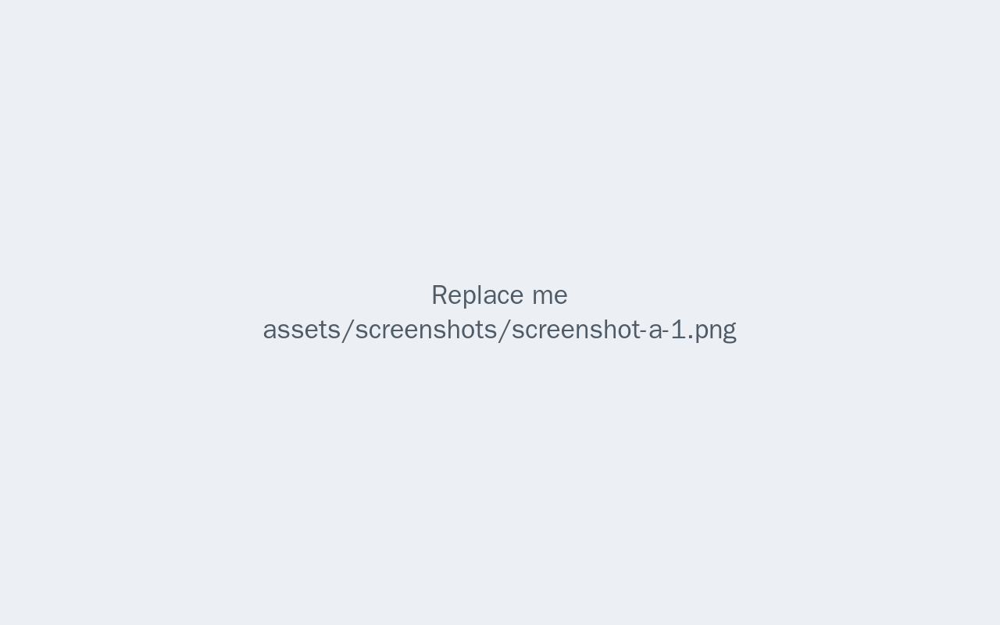
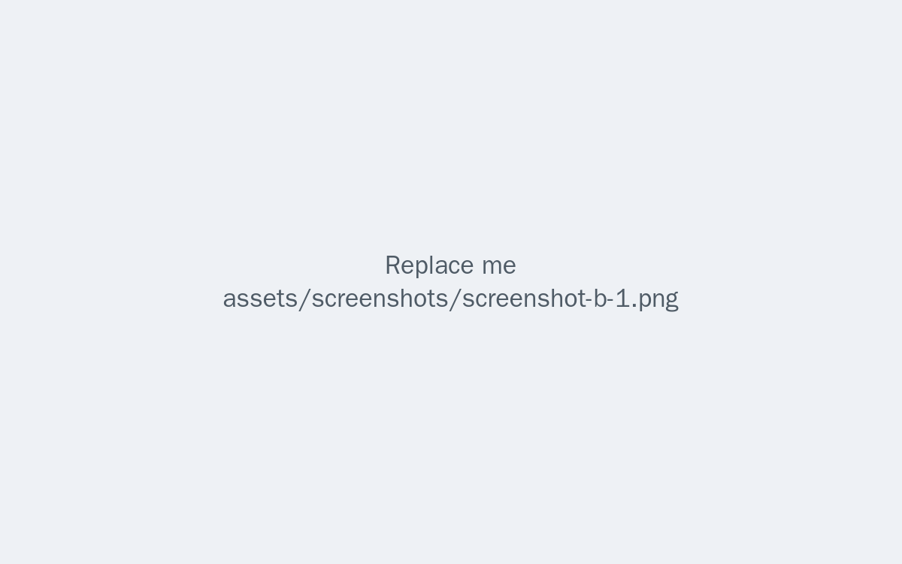
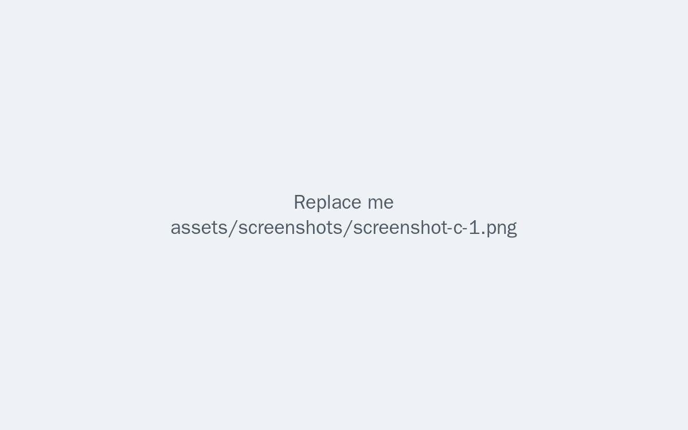

# Platform Screenshots {.unnumbered}

<!-- TODO: Replace each figure below with a real screenshot of the running
platform. Keep one figure per line with a caption:
`{width=75%}`.
Some sections below are optional — keep the ones you have, remove the rest.
Each PNG filename should match a real file kept on GitHub so the repo is
self-contained. -->

## Module A

{width=75%}

{width=75%}

## Module B

{width=75%}

## Module C

{width=75%}